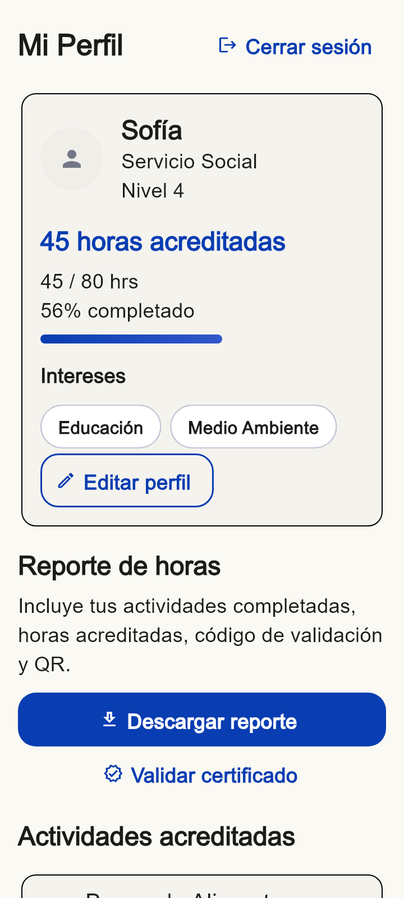

# Rogelio Montalvo — R5 — 20245284

## Alcance y rama

Trabajo del 2 de noviembre de 2026 en `feat/rogelio-acreditar`, creada desde
`origin/master` (`7eea1e8`). Se siguió el reparto final, sección 3.6, y las
indicaciones de RAMAS, que actualizan el reparto antiguo de README/PLAN/ENTREGA.
No se modificaron archivos de otros integrantes, modelos, contratos, reglas,
dependencias ni la rama `master`.

## Implementación

- `features/accreditation/`: diálogo y provider. Consulta la postulación actual
  de la organización autenticada, valida horas enteras positivas y bloquea envíos
  repetidos. Aceptadas/confirmadas pasan por `enCurso` antes de `completado`, como
  exige el contrato. Una postulación completada no se vuelve a acreditar.
- `features/profile/`: perfil con datos de sesión, horas de ApplicationsProvider,
  meta e intereses editables, estados de carga/vacío/error/datos, reporte PDF y
  consulta de certificados por código. El provider se crea dentro de la pantalla
  para conservar la integración existente sin editar `main.dart`.
- `firestore_certificate_data_source.dart`: implementa el contrato existente.
  Usa una transacción que impide reemplazar un código ya registrado. La consulta
  pide datos al servidor para distinguir errores de conexión de códigos ausentes.
- El código se obtiene de CertificateRepository, que ya usa `Random.secure` y el
  formato NOD-XXXX-XXXX. El reporte se ofrece únicamente después del guardado.
  Reintentar la descarga de la misma instantánea reutiliza sus bytes y código.
- PDF con actividades completadas, organizaciones, fechas, horas, total y QR.
  El QR lleva el código del certificado. No existe una web de validación en la
  base; la consulta implementada está en Perfil → Validar certificado.

## Errores y soluciones

| Síntoma | Herramienta | Causa | Solución y comprobación |
|---|---|---|---|
| `flutter pub get` rechaza el SDK | Flutter y resolvedor de Pub | Dart instalado 3.13.2; proyecto exige ^3.13.5 | SDK separado Flutter 3.47.9 / Dart 3.13.7, sin cambiar pubspec. Analyze y tests ejecutados con él. |
| Analyze reporta estilo de constructores e importación innecesaria | `flutter analyze` | Campos asignados desde parámetros, import duplicado y if sin llaves | Inicializadores formales, import eliminado y bloques con llaves. Analyze sin hallazgos. |
| Falla el humo de Javier al cerrar sesión | Suite completa del equipo | El botón estaba al final de una lista que construye elementos al desplazarse | Botón en la cabecera del perfil. Su test original pasa sin modificaciones. |
| La prueba nueva no encuentra LoadingView | Prueba de widget | Ese elemento estaba fuera del área construida del sliver | Se verifica el indicador visible; se completa el stream y se comprueba el estado vacío. |
| Se podían conservar datos anteriores después de un error del stream | Revisión del provider y prueba con StreamController | El manejador guardaba el error sin descartar la postulación anterior | Se descarta esa postulación y se bloquea acreditar hasta recibir datos válidos. La prueba confirma que no se escribe. |
| La captura temporal se queda esperando al generar PDF | Prueba temporal de evidencia | `testWidgets` usa un reloj controlado; el generador trabaja de forma asíncrona | Ejecutar esa exportación de evidencia con `tester.runAsync`. El generador real también se prueba fuera de testWidgets. |
| Windows avisa que necesita soporte de enlaces simbólicos | `flutter pub get` | Modo de desarrollador desactivado para plugins de escritorio | Se conservaron la configuración del sistema y los archivos del equipo; se ejecutaron analyze/test con las dependencias resueltas y `--no-pub`. La prueba Android se registra aparte. |

## Validación realizada

`flutter test --no-pub`: **51 pruebas aprobadas**, incluidas 16 nuevas de Rogelio.
Se conservaron todos los tests anteriores del equipo.

Las nuevas pruebas cubren transiciones, permisos de organización, horas inválidas,
acreditación repetida, reintento después de un fallo, actualización de horas en
ApplicationsProvider, edición de meta e intereses, formato y consulta del código,
archivo PDF real, reutilización de reporte, fallo del guardado, cambio de sesión,
perfil a 360 px con texto 1.3 y estados cargando/datos/vacío/error.

El humo de integración usa los componentes existentes: aceptar con
ApplicantsProvider → aviso → acreditar → sesión del voluntario → horas del perfil
→ emitir y validar el PDF. Es una prueba de integración con Fake; no demuestra
que el panel pendiente de José ya permita recorrer todas esas pantallas.

Se renderizó y revisó el reporte de una página y una tabla de 60 actividades en
tres páginas. Se decodificó el QR del PDF con ZXing: `NOD-ABCD-EFGH`, idéntico al
código de la muestra. Ese código fijo pertenece solo a la evidencia temporal;
la app genera códigos aleatorios. La prueba de emisión con Fake exige menos de
3 segundos. No se afirma que ese tiempo esté medido con Firebase real.

Compilación Android: `flutter build apk --debug --dart-define=NODARA_FAKE=true
--no-pub` completó correctamente y generó `app-debug.apk`. La primera ejecución
preparó las dependencias nativas que faltaban (Android SDK Platform 35 y CMake
3.22.1). No se alteraron archivos Gradle, manifests ni configuraciones compartidas.
No había un dispositivo conectado: compilar el APK no equivale a probar la hoja
de compartir del sistema en un teléfono. La captura del perfil usa el harness
de widgets a 360 px con texto 1.3 y una fuente local para la evidencia.

## Integración que corresponde a los otros dueños

1. **Jhonnatan:** importar FirestoreCertificateDataSource en AppDependencies y
   usarlo únicamente en `AppDependencies.firebase()`. En master esa fábrica aún
   usa FakeCertificateDataSource. No se debe reemplazar el Fake en `.fake()`.
2. **Alejandra:** permitir el botón de acreditar para aceptadas, confirmadas y
   en curso. Ahora lo muestra solo para `enCurso` y si recibe `onAccredit`.
3. **José:** abrir ApplicantsScreen desde su panel, pasando `opportunityId` y el
   callback `showAccreditationDialog(context, application)` de este módulo.

Hasta esa conexión, Perfil funciona con las dependencias actuales; los
certificados siguen en memoria incluso si otras partes están usando Firebase.
No se hicieron escrituras de prueba en la base Firebase del equipo.

El parche de conexión se verificó en una copia separada del repositorio, sin
aplicarlo a la rama de Rogelio: análisis sin hallazgos y 52 pruebas aprobadas
(las 51 de la rama más una prueba del botón de Postulantes). Esa prueba abre
el diálogo desde `aceptado`, confirma horas y comprueba `completado` en la lista.

## Uso de IA

Consulta: revisar el documento y el repositorio, implementar la parte asignada a
Rogelio sin cambiar master ni archivos de otros, y verificar que siga funcionando
el proyecto completo. Codex generó y revisó código, pruebas y documentación de R5;
también ayudó a diagnosticar la incompatibilidad del SDK y la regresión del botón.
Se verificaron los cambios con el analizador, la suite completa, las pruebas
de widget y la inspección/decodificación del PDF. Esta bitácora declara esa ayuda:
no es una declaración de que todo el código haya sido escrito manualmente por
Rogelio. Rogelio debe leerlo y poder explicarlo antes de presentarlo como aporte.

Fuentes técnicas consultadas: [pdf](https://pub.dev/packages/pdf),
[printing](https://pub.dev/packages/printing) y
[transacciones Firestore](https://firebase.google.com/docs/firestore/manage-data/transactions).
El guardado sin reemplazo sigue el patrón de lectura y escritura en una
transacción descrito por Firebase. El envío del archivo usa Printing.sharePdf,
documentado por el paquete printing.

